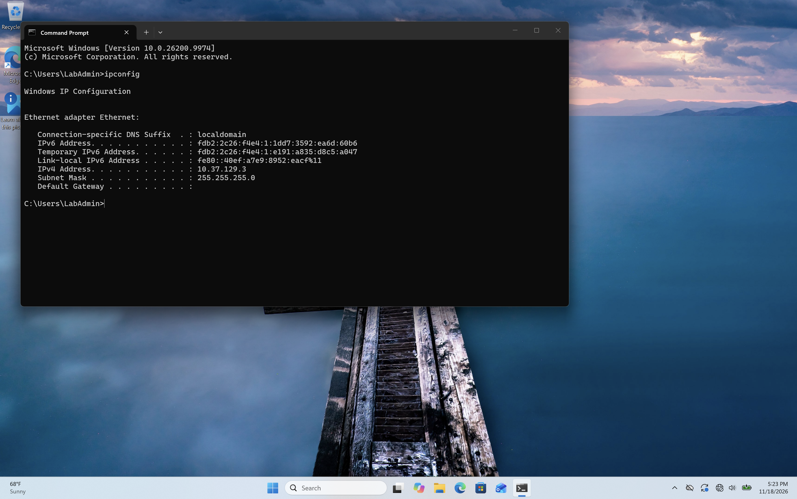

# Lab Exercise 01: Windows 11 Workstation Setup

## 1. Objective
Configure an isolated Windows 11 ARM64 virtual machine on an Apple Silicon host to serve as a lab workstation for practicing IT support, system administration, and cybersecurity fundamentals.

## 2. Environment and Hardware 

| Component | Configuration |
|---|---|
| Host Machine | MacBook – Apple M4 Series |
| Hypervisor | Parallels Desktop Pro |
| Guest OS | Windows 11 ARM64 |
| Network Configuration | Host-Only Network |
| Assigned Lab IP | 10.37.129.3 |

## 3. Configuration Steps Completed

### Windows Updates and System Baseline

- Installed Parallels Tools.
- Navigated to Settings > Windows Update.
- Downloaded and installed pending Windows updates.

### Local Account Configuration

- Navigated to Settings > Accounts > Other users.
- Continued without a Microsoft account.
- Created a local user account with a username and password.
- Changed the account type to administrator.

### Personal Microsoft Account Removal

- Signed into the newly created local administrator account.
- Navigated to Settings > Accounts > Other users.
- Removed the personal Microsoft-linked user account
  and its associated local user profile from the virtual machine.

### Host-Guest Isolation

- Enabled Parallels security isolation to disable shared
  folders, clipboard sync, and drag-and-drop.

### Network Isolation

- Switched the virtual network adapter from Shared (NAT)
  to Host-Only networking.

**Security Consideration:**

- Separated personal and lab user accounts to reduce
  unnecessary exposure of personal information within
  the lab environment.

**Snapshots Captured:**

| Snapshot Name | Purpose |
|---|---|
| 01_Windows11_Updated | Establish an updated Windows baseline with a local administrator account. |
| 02_Windows11_Isolated_Ready | Preserve the configured host-only network and host-guest isolation settings. |

## 4. Configuration Verification

| Verification Method | Observed Result |
|---|---|
| Microsoft Edge connectivity test | External website access unsuccessful | 
| Windows File Explorer inspection | Shared macOS directories no longer visible | 
| `ipconfig` | Confirmed private IPv4 address assignment | 

## 5. Lessons Learned

- Configuring Windows 11 ARM64 within a virtualized environment.
- Establishing an updated operating system baseline.
- Managing local Windows user accounts.
- Understanding host-guest and network isolation.
- Using virtual machine snapshots for configuration recovery.
- Validating system and network configurations.

## 6. Conclusion

Successfully configured a Windows 11 ARM64 virtual machine
to serve as a controlled workstation within the cybersecurity
home lab.

The configuration established an updated operating system
baseline, a dedicated local administrator account, host-guest
isolation, and host-only networking.

This workstation serves as the foundation for future IT
support, system administration, networking, and cybersecurity
exercises.