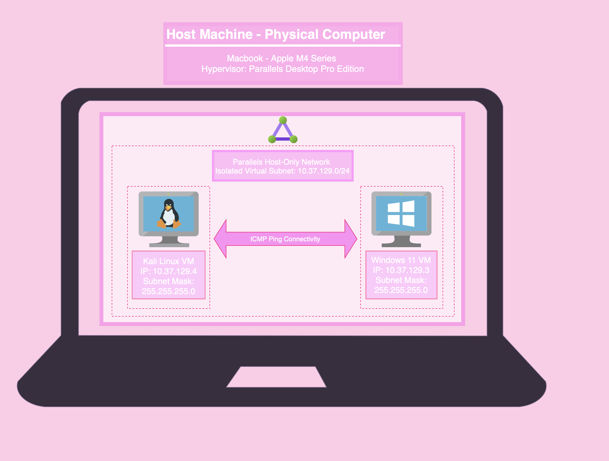

# Lab Exercise 02: Windows 11 – Kali Linux Network Connectivity & Isolation

## 1. Objective

Establish and validate network connectivity between an isolated Windows 11 ARM virtual machine and a Kali Linux virtual machine running within the home lab environment.

The objective is to configure and test communication between both virtual machines, investigate an initial unsuccessful ICMP ping, troubleshoot the connectivity issue, and verify successful communication while maintaining network isolation.

## 2. Environment and Hardware

| Component | Configuration |
|---|---|
| Host Machine | MacBook – Apple M4 Series |
| Hypervisor | Parallels Desktop Pro |
| Windows VM | Windows 11 ARM64 |
| Linux VM | Kali Linux ARM64 |
| Network Configuration | Host-Only Network |
| Windows IP Address | 10.37.129.3 |
| Kali IP Address | 10.37.129.4 |

## 3. Network Architecture and Isolation

### Network Configuration

- Configured the virtual machines to communicate within the designated lab network.
- Reviewed the virtual network adapter settings in Parallels Desktop.
- Used a Host-Only network configuration to isolate lab traffic from the external network.
- Verified the IP configuration of both virtual machines.

### Network Topology



### Security Considerations

Network isolation provides a controlled environment for practicing network administration, troubleshooting, and cybersecurity fundamentals.

The objective is to permit communication between designated lab machines without unnecessarily exposing the virtual machines to external networks.

## 4. IP Address Configuration

### Windows 11

Command executed:

```powershell
ipconfig
```

- IPv4 Address: `10.37.129.3`
- Subnet Mask: `255.255.255.0`
- Default Gateway: Not displayed, absence of a default gateway is consistent with an isolated Host-Only setup.

**Evidence:** [Network Configuration](evidence/01-network-configuration/)

### Kali Linux

Command executed:

```bash
ip -br addr
```

- IPv4 Address: `10.37.129.4`
- Subnet Mask: `255.255.255.0`
- Prefix Length: `/24`
- Network Address: `10.37.129.0/24`
- Network Interface: `eth0`

**Evidence:** [Network Configuration](evidence/01-network-configuration/)

## 5. Initial Connectivity Test – Unsuccessful

### Test Description

Performed an initial ICMP connectivity test between the Windows 11 and Kali Linux virtual machines using the ping command.

Command executed:

```bash
ping -c 4 10.37.129.3
```

### Initial Result

- Connectivity test: Unsuccessful
- Packet loss: 100%
- Ping statistics: 4 packets transmitted, 0 received, 100% packet loss, time 3070 ms

### Initial Observations

The initial ping test did not establish successful communication between the two virtual machines.

Further investigation was required to identify the cause of the connectivity failure.

**Evidence:** [Initial Ping Failure](evidence/02-initial-ping-failure/)

## 6. Troubleshooting and Corrective Actions

Investigated the virtual network configuration and connectivity settings of both virtual machines.

**Areas reviewed:**  

- Parallels virtual network adapter configuration.
- Windows and Kali IP address assignments.
- Network isolation and subnet configuration.
- ICMP connectivity and firewall settings.

**Corrective actions performed:**

1. Verified Kali IP address and looked for active network interface.
2. Verified Windows IP address.
3. Checked Windows Defender Firewall.
   - The firewall appeared to be blocking incoming ICMP echo requests. 

4. Opened PowerShell as an administrator and executed the following command: 

   ```powershell
   Get-NetFirewallRule -DisplayName "Lab ICMPv4 Echo"
   ```

   - This cmdlet checks for an existing firewall rule with the specified display name. 

5. The firewall rule did not exist, so it was created using the following command: 

   ```powershell
   New-NetFirewallRule -DisplayName "Lab ICMPv4 Echo" -Protocol ICMPv4 -IcmpType 8 -Direction Inbound -Action Allow -RemoteAddress 10.37.129.0/24
   ```

**Firewall Rule Configuration:**
- Created a custom inbound firewall rule.
- Specified ICMPv4 as the network protocol.
- Configured ICMP Type 8 to permit Echo Requests.
- Set the direction to inbound.
- Configured the firewall action to allow matching traffic.
- Restricted remote sources to the 10.37.129.0/24 subnet.

**Security Consideration:** 
- Applied the principle of least privilege by restricting inbound ICMPv4 echo requests to the designated lab subnet rather than allowing ping requests from all remote addresses. 

**Evidence:** [Win11 Defender Firewall Configuration](evidence/03-win11-defender-firewall-configuration/)

## 7. Successful Connectivity Test

### Test Description

Repeated the ICMP ping test after making the necessary configuration adjustments.

Command executed:

```bash
ping -c 4 10.37.129.3
```

### Results

- Connectivity test: Successful
- Packets transmitted: 4
- Packets received: 4
- Packet loss: 0%
- Total test duration: 3019 ms

### Verification

Successful ping responses confirmed that the two virtual machines could communicate over the configured lab network.

**Evidence:** [Successful Connectivity](evidence/04-successful-connectivity/)

## 8. Security Observations

- Maintained a controlled virtual lab environment.
- Used network isolation to limit unnecessary external connectivity.
- Observed how network configuration affects communication between virtual machines.
- Identified the importance of validating IP addressing and ICMP traffic when troubleshooting connectivity.

## 9. Lessons Learned

- Understanding virtual network adapter configurations.
- Identifying and troubleshooting connectivity failures.
- Using `ipconfig`, `ip addr`, and `ping` to validate network configurations.
- Understanding ICMP communication between Windows and Linux systems.
- Applying network isolation principles in a cybersecurity home lab.

## 10. Conclusion

Successfully configured and tested connectivity between the Windows 11 ARM64 and Kali Linux virtual machines within the cybersecurity home lab.

The initial unsuccessful connectivity test provided an opportunity to investigate network configuration and troubleshoot communication issues.

Following corrective actions, successful ICMP responses verified connectivity between the two virtual machines within the isolated lab environment.

This exercise establishes a foundation for future network monitoring, security testing, and help desk troubleshooting exercises.