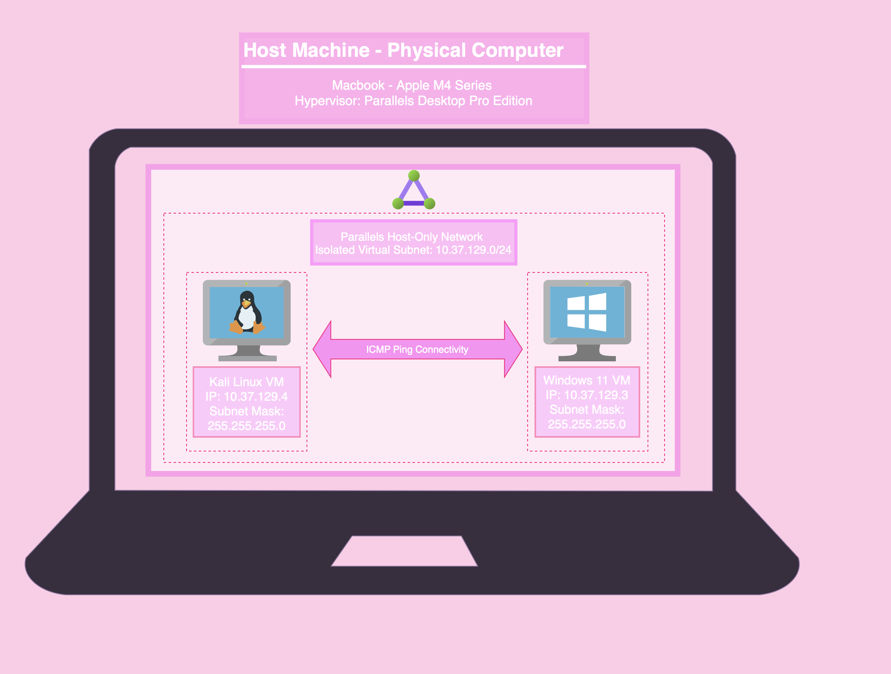

# Cybersecurity Home Lab

**Author:** Grace Akins  
**Focus:** Cybersecurity | Help Desk | System Administration  
**Status:** Actively Developing

> "Great things are not done by impulse, but by a series of small things brought together."
>
> - Vincent van Gogh

## About This Project

Welcome to my cybersecurity home lab!

I created this project to develop practical, hands-on cybersecurity skills beyond theoretical learning. My goal is to build a strong technical foundation while gaining experience in networking, system administration, security configurations, troubleshooting, and defensive security practices.

This repository documents my learning process, including successful configurations, failed attempts, troubleshooting methodologies, and lessons learned.

## Project Objectives

- Develop practical cybersecurity and networking skills.
- Understand Windows and Linux operating systems.
- Configure and maintain controlled virtual environments.
- Strengthen technical troubleshooting and analytical abilities.
- Understand security configurations and their implications.
- Develop professional technical documentation habits.
- Build a portfolio demonstrating my technical growth and capabilities.

## Lab Environment

| Component | Technology |
|---|---|
| Host Operating System | macOS |
| Virtualization Platform | Parallels Desktop |
| Windows Virtual Machine | Windows 11 |
| Linux Virtual Machine | Kali Linux |
| Network Configuration | Host-Only |
| Documentation | Markdown and VS Code |
| Version Control | Git |
| Diagramming | draw.io |

## Project Progress

### Phase 1: Home Lab Baseline

**Status:** Completed

Established a controlled virtual lab environment to serve as the foundation for future cybersecurity exercises.

Activities included:

- Windows 11 virtual machine configuration.
- Windows and Kali Linux network configuration.
- IP addressing and subnet validation.
- Network connectivity troubleshooting.
- Windows Defender Firewall configuration.
- Subnet-restricted ICMP communication.
- Network topology documentation.

### Lab Documentation

| Lab | Description |
|---|---|
| [01 - Windows 11 Setup](01-Home-Lab-Baseline/01-Windows11-Setup/windows-11-setup.md) | Initial Windows virtual machine setup and configuration. |
| [02 - Windows-Kali Networking](01-Home-Lab-Baseline/02-Windows-Kali-Networking/windows-kali-connectivity.md) | Network configuration, connectivity testing, firewall configuration, and troubleshooting. |

## Network Topology

## Technical Skills Demonstrated

- Virtual machine configuration
- IPv4 addressing and subnetting
- Network isolation
- ICMP connectivity testing
- Windows Defender Firewall administration
- PowerShell and Linux command-line fundamentals
- Systematic troubleshooting
- Technical documentation
- Network topology diagramming

## Troubleshooting Philosophy

My approach to technical problems is to:

1. Identify the issue.
2. Gather relevant information.
3. Investigate potential causes.
4. Implement corrective actions.
5. Validate the results.
6. Document the process and lessons learned.

The goal is not simply to make something work, but to understand why it works.

## Future Learning Objectives

### IT Support and System Administration
- Active Directory
- File permissions
- Group Policy
- Ticketing simulations

### Cybersecurity
- Wireshark
- Network traffic analysis
- Packet capture and inspection
- Vulnerability assessment
- Security monitoring and log analysis
- System hardening
- Threat detection
- Incident response fundamentals

## Ethics and Security

All activities documented in this repository are conducted within an authorized, controlled home lab environment for educational and professional development purposes.

## About Me

My interest in technology started long before I understood how it worked. Growing up, I spent countless hours playing on my Nintendo DS, Wii, and Xbox, never imagining that one day I would be configuring my own virtual network.

I entered the field of information security with very little technical knowledge and no prior computer science coursework. After discovering an information security program, I became fascinated by the field and wanted to understand the technology I had spent so much of my life using.

I am now pursuing opportunities in IT support and cybersecurity while developing my technical skills through hands-on learning, experimentation, and troubleshooting.

This repository represents my growth, curiosity, and willingness to learn — one command, configuration, and troubleshooting session at a time.

## Connect With Me

- [LinkedIn](https://www.linkedin.com/in/grace-akins/)
