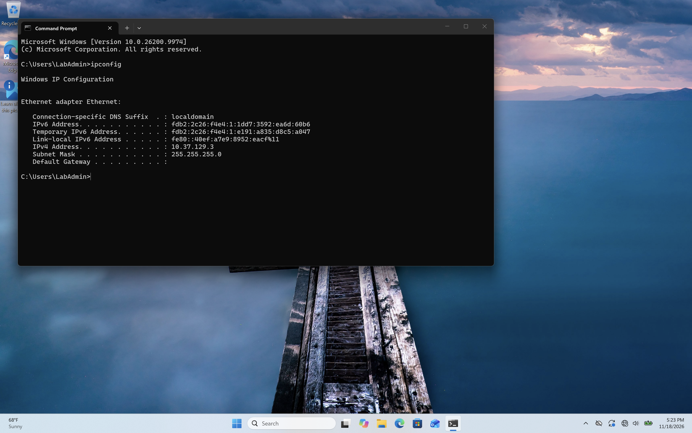

# Beginner Home Lab Setup: Windows 11 Workstation

## 1. Objective
Configure an isolated Windows 11 ARM virtual machine on Apple Silicon M series to serve as a target workstation and helpdesk/security practice environment. 

**Complete Windows Updates**
* Settings > Windows Update 
* Download & Install any updates required 
* After completion, shut down computer

**Create a Local Account**
* Settings > Accounts > Other users 
* Bypass the email prompt and continue without a Microsoft Account
* Create username & password
* Change account type to administrator 

**Remove your Cloud Account**
* Sign into local account you just created
* Open Settings > Accounts > Other users 
* Click the dropdown arrow next to your previous account and click **remove** to completely wipe your personal cloud profile from the virtual machine.

**Final Steps**
* Shut down Windows 11 completely 
* Take your first **snapshot** with the Local Account logged in, completed Windows 11 updates, and while you still have an active internet connection. This creates a clean, patched, and fully functional baseline before you lock the virtual machine down into an isolated environment. 

## 2. Environment and Hardware 
**Host Machine:** Macbook (Apple M4 Series)
**Hypervisor:** Parallels Desktop Pro Edition
**Guest OS:** Windows 11 ARM64
**Assigned Lab IP:** 10.37.129.3

## 3. Configuration Steps Completed
**System Baseline:** Installed Parallels Tools and applied all pending Windows Updates.
**Account Hardening:** Created local administrator account (LabAdmin) and removed personal Microsoft account credentials.
**Host-Guest Isolation:** Enabled Parallels security isolation to disable shared folders, clipboard sync, and drag-and-drop. 
**Network Isolation:** Switched virtual network adapter from Shared (NAT) to **Host-Only Networks**. 

**Snapshots Captured:**
* 01_Windows11_Updated (Updated OS + local admin)
* 02_Windows11_Isolated_Ready (Full network and host isolation verified)

## 4. Verification & Proof
* Confirmed outbound internet access is blocked in Microsoft Edge.
* Verified macOS directories are no longer visible in Windows File Explorer. 
* Ran ipconfig in Command Prompt to confirm private subnet assignment. 

